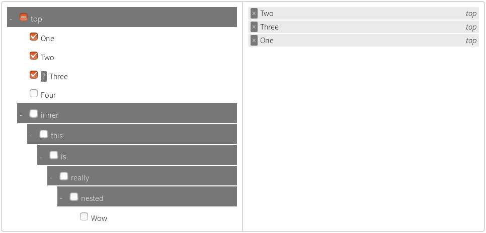

## Tree Multiselect

**This plugin allows you to add a sweet treeview frontend to a `<select>` node.**
The underlying `<select>` node can be used as it was before. Read its value with
`selectElement.value`, or, for every selected option,
`Array.from(selectElement.selectedOptions, (option) => option.value)`, as if
there was no plugin. If you want to add options dynamically, please continue
reading, there are some more steps you need to take.

* Make sure you've got `<meta charset="UTF-8">` in your `<head>` or some of the symbols may look strange.
* Requires an environment that can consume ES modules (a bundler, or a browser that supports `import`). There are no runtime dependencies.

### Browser support

- Chrome 61+
- Firefox 60+
- Safari 11.1+
- Chromium-based Edge 79+
- IE11 is not supported (the package is ESM-only).

The published code is ES2017. Drag sorting uses Pointer Events when available and falls back to mouse/touch events on Safari 11–12; FLIP animations are skipped where the Web Animations API is missing. Dark mode, `accent-color`, custom scrollbars and the custom focus ring are progressive enhancements: older browsers fall back to native controls and the light palette.



### How To Use
1. Set the `multiple="multiple"` attribute on your `<select>`
2. Add attributes to `<option>` nodes
3. Call `treeMultiselect(select, params)` with whatever params you want

### Setting up your `<select>`
* Make sure your `<select>` has the `multiple` attribute set.

The `<option>` children can have the following attributes.

#### Option Attributes
Option Attribute name         | Description
----------------------------- | ---------------------------------
`selected`                    | Have the option pre-selected. This is actually part of the HTML spec. For specified ordering of these, use `data-index`
`readonly`                    | User cannot modify the value of the option. Option can be selected (ex. `<option selected readonly ...`)
`data-section`                | The section the option will be in; can be nested
`data-description`            | A description of the attribute; will be shown on the multiselect
`data-index`                  | For pre-selected options, display options in this order, lowest index first. Repeated items with the same index will be shown before items with a higher index. Otherwise items will be displayed in the order of the original `<select>`

All of the above are optional.

Your `data-section` can have multiple section names, separated by the `sectionDelimiter` option. If you don't have a `data-section` on an option, the option will be on the top level (no section).

Ex. `data-section="top/middle/inner"` will show up as
- `top`
  - `middle`
    - `inner`
      - your option

### API
#### `treeMultiselect(target, params?)`
Renders a tree for the given `<select>` element(s). `params` is optional.
`target` can be a single `HTMLSelectElement`, an array, or any iterable of
`HTMLSelectElement` (for example a `NodeList`). It returns an array of handles,
one per select, in the same order as the targets.

```javascript
import { treeMultiselect } from 'tree-multiselect-next';

const [tree] = treeMultiselect(document.querySelector('select'));
```
```javascript
let params = {searchable: true};
const handles = treeMultiselect(document.querySelectorAll('select'), params);
```
```javascript
function treeOnChange(allSelectedItems, addedItems, removedItems) {
  console.log("something changed!");
}

treeMultiselect(document.querySelector('select'), {
  allowBatchSelection: false,
  onChange: treeOnChange,
  startCollapsed: true
});
```

##### Params
Name                    | Default        | Description
----------------------- | -------------- | ---------------
`allowBatchSelection`   | `true`         | Sections have checkboxes which when checked, check everything within them
`collapsible`           | `true`         | Adds collapsibility to sections
`enableSelectAll`       | `false`        | Enables selection of all or no options
`selectAllText`         | `Select All`   | Only used if `enableSelectAll` is active
`unselectAllText`       | `Unselect All` | Only used if `enableSelectAll` is active
`freeze`                | `false`        | Disables selection/deselection of options; aka display-only
`hideSidePanel`         | `false`        | Hide the right panel showing all the selected items
`maxSelections`         | `0`            | A number that sets the maximum number of options that can be selected. Any positive integer is valid; anything else (such as `0` or `-1`) means no limit
`onChange`              | `null`         | Callback for when select is changed. Called with (allSelectedItems, addedItems, removedItems), each of which is an array of objects with the properties `text`, `value`, `initialIndex`, and `section`
`onlyBatchSelection`    | `false`        | Only sections can be checked, not individual items
`sortable`              | `false`        | Selected options can be sorted by dragging
`searchable`            | `false`        | Allows searching of options
`searchParams`          | `['value', 'text', 'description', 'section']` | Set items to be searched. Array must contain `'value'`, `'text'`, or `'description'`, and/or `'section'`
`sectionDelimiter`      | `/`            | Separator between sections in the select option `data-section` attribute
`showSectionOnSelected` | `true`         | Show section name on the selected items
`startCollapsed`        | `false`        | Activated only if `collapsible` is true; sections are collapsed initially

#### Examples


#### `.remove()`
Removes the tree from the DOM. Leaves the original `<select>` intact.
```javascript
const [tree] = treeMultiselect(document.querySelector('select'), {searchable: true});
tree.remove();
```

#### `.reload()`
Reinitializes the tree. You can add `<option>` children to the original `<select>` and call `.reload()` to render the new options. User-changed selections will be saved.

```javascript
const [tree] = treeMultiselect(document.querySelector('select'));

// add an option
const option = document.createElement('option');
option.value = 'newValue';
option.setAttribute('data-section', 'New Section');
option.setAttribute('data-description', 'New value');
option.selected = true;
option.textContent = 'New Value';
document.querySelector('select').append(option);

tree.reload();
```

### Installation

```bash
npm install tree-multiselect-next
```

The package is ES-module only and has no runtime dependencies.

```javascript
import { treeMultiselect } from 'tree-multiselect-next';
import 'tree-multiselect-next/style.css'; // optional, but recommended

treeMultiselect(document.querySelector('select'), {searchable: true});
```

`sortable: true` needs no extra library: it uses Pointer Events with a mouse/touch fallback for older Safari, and FLIP animations where supported. All motion is disabled when the user prefers reduced motion.

### Theming

The stylesheet reads its colors and radii from CSS custom properties on `.tree-multiselect`, so the accent color (and the rest of the palette) can be changed without forking the CSS:

```css
.tree-multiselect {
  --tm-accent: #0f766e;
  --tm-accent-soft: #ccfbf1;
  --tm-radius: 10px;
}
```

Available variables: `--tm-accent`, `--tm-accent-soft`, `--tm-bg`, `--tm-surface`, `--tm-bg-subtle`, `--tm-border`, `--tm-border-strong`, `--tm-text`, `--tm-text-muted`, `--tm-hover`, `--tm-danger`, `--tm-danger-soft`, `--tm-focus-ring`, `--tm-shadow`, `--tm-radius`, `--tm-radius-sm`. All target browsers support CSS custom properties; dark mode is applied automatically through `prefers-color-scheme: dark` where it is supported.

### Next.js / SSR

The package entry is side-effect free and safe to import where there is no DOM:
it only exports the function. The plugin itself needs a browser, so call
`treeMultiselect` after mount.

```tsx
"use client";

import { useEffect, useRef } from "react";
import { treeMultiselect } from "tree-multiselect-next";
import type { TreeMultiselectHandle } from "tree-multiselect-next";

export default function TreeSelect() {
  const selectRef = useRef<HTMLSelectElement>(null);

  useEffect(() => {
    if (!selectRef.current) return;
    const [tree]: TreeMultiselectHandle[] = treeMultiselect(selectRef.current, { searchable: true });
    return () => tree.remove();
  }, []);

  return (
    <select ref={selectRef} multiple defaultValue={["peach"]}>
      <option value="blueberry">Blueberry</option>
      <option value="peach">Peach</option>
    </select>
  );
}
```

Notes:

- Import the stylesheet from a global CSS file (App Router: `app/layout.tsx`):
  `import "tree-multiselect-next/style.css";`
- Calling `tree.remove()` in the effect cleanup keeps React StrictMode's
  double-invoked effects safe.
- The `TreeMultiselectHandle` import is type-only, so it is erased at build time.

### TypeScript

Type declarations ship with the package and are generated from the source, so they always match the implementation. Four types are exported for annotating your own code:

- `TreeMultiselectOptions` — the `params` object
- `TreeMultiselectItem` — the objects passed to `onChange`
- `TreeMultiselectHandle` — what each element of the returned array provides (`reload()` / `remove()`)
- `TreeMultiselectTarget` — what `treeMultiselect` accepts as its first argument

```typescript
import { treeMultiselect } from 'tree-multiselect-next';
import type { TreeMultiselectOptions, TreeMultiselectItem, TreeMultiselectHandle } from 'tree-multiselect-next';

const options: TreeMultiselectOptions = {
  searchable: true,
  onChange: (all: TreeMultiselectItem[]) => console.log(all)
};

const handles: TreeMultiselectHandle[] = treeMultiselect(document.querySelectorAll('select'), options);
handles[0].reload();
```

### How to build
- Install dependencies: `npm install`
- Run tests and linting: `npm test`
- Type-check and lint only: `npm run typecheck`, `npm run lint`
- Check the ES2017/CSS fallback baseline: `npm run check:legacy`
- Build the distributable files into `dist/`: `npm run build`
- Serve the demo pages: `npm run dev`

### FAQ
`Help! The first element is selected when I create the tree. How do I make the first element not selected?`
You didn't set the `multiple` attribute on your `<select>`. This is a property of single-option select nodes - the first option is selected.

### License
MIT licensed.
